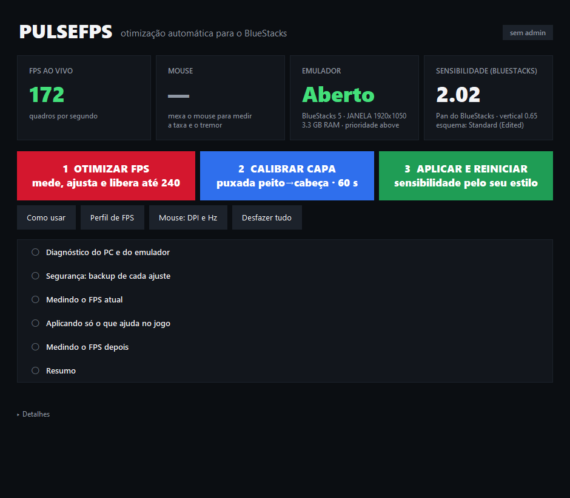
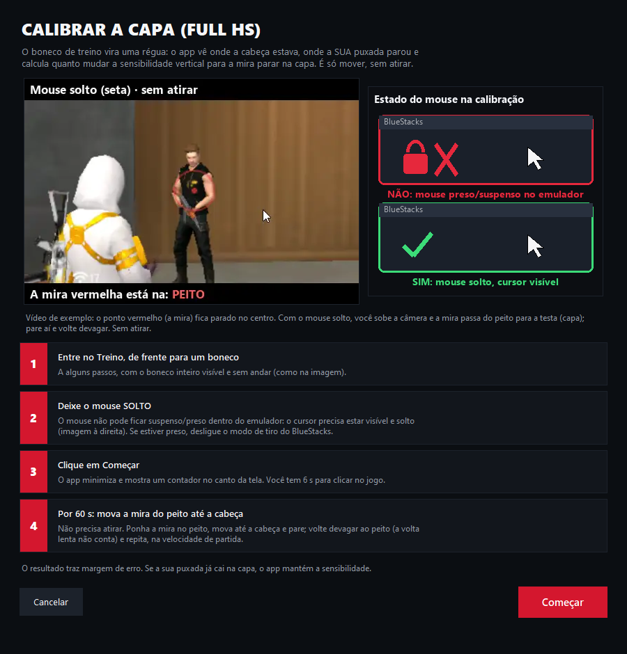
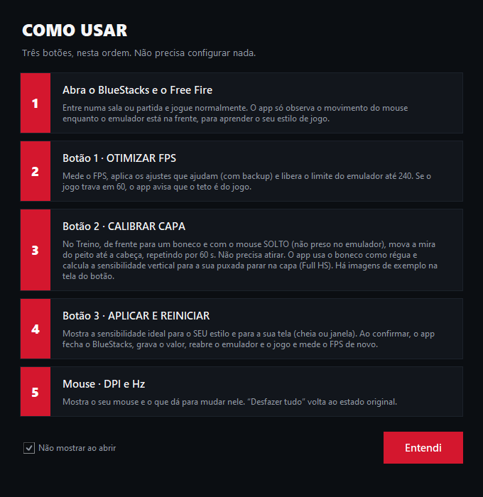

# PulseFPS

**Otimização automática do BlueStacks para Free Fire: mais FPS e a sensibilidade certa para dar capa (Full HS).**
Gratuito, de código aberto (MIT) e sem instalação: é só abrir o `.exe`.

  
  &nbsp;
  

## Os 3 botões
| | | |
|---|---|---|
| **1 · OTIMIZAR FPS** | Mede o FPS, aplica ajustes seguros (com backup) e libera o limite do BlueStacks até 240 FPS | Se o jogo trava em 60, o app avisa que o teto é do jogo |
| **2 · CALIBRAR CAPA** | No Treino, mova a mira do peito até a cabeça do boneco por 60 s, sem atirar e com o mouse solto | O boneco vira uma régua: o app mede onde a sua puxada para e corrige a sensibilidade **vertical** |
| **3 · APLICAR E REINICIAR** | Grava a sensibilidade, reinicia o BlueStacks e o Free Fire e mede o FPS de novo | Aprende o seu estilo de jogo pelos giros do mouse |

Também: **Perfil de FPS** (perfil de dispositivo para tentar liberar 90 FPS), **Mouse Fix completo** (ponteiro 1:1 e ajustes de entrada) e **Desfazer tudo**.

## Como usar
1. Baixe o `PulseFPS_1.0.zip` na página de [**Releases**](https://github.com/DarlingSz/PulseFPS-Download/releases/latest) e extraia.
2. Abra o `PulseFPS.exe` e confirme o aviso de **administrador** (necessário).
3. Abra o BlueStacks e o Free Fire e use os botões **1, 2 e 3** na ordem. O botão **Como usar** explica tudo na tela.

## O que ele **não** faz
- **Não existe mira perfeita.** Tremor da mão, mouse de 125 Hz e o próprio jogo (recuo, assistência de mira) ficam fora do alcance de qualquer programa.
- **Não troca o DPI nem o Hz do mouse**: isso fica no firmware, e cada fabricante usa um protocolo próprio.
- **90 FPS não é garantido**: o perfil de dispositivo é uma tentativa; se não ajudar, volte ao original no botão "Perfil de FPS".
- Não lê memória nem altera arquivos do jogo; não desativa Defender, Firewall, Windows Update nem serviços.

## Segurança e confiança
- Tudo que o app altera tem **backup**, e **Desfazer tudo** restaura. Os dados ficam só no seu PC (`%LOCALAPPDATA%\PulseFPS`).
- O arquivo **não é assinado digitalmente**: o SmartScreen ou o antivírus podem avisar (falso positivo comum em programas feitos com
  PyInstaller). Confira o hash e, se preferir, **audite e compile você mesmo** o [código-fonte](https://github.com/DarlingSz/PulseFPS).
- Testado em **BlueStacks 5 + Free Fire, Windows 10**, em um único PC. Em outras versões pode não funcionar.

| Arquivo | SHA-256 |
|---|---|
| `PulseFPS.exe` | `2e6a4621a0d673d3078f361daecbd1d2b8f128b96c755b39b40fb72533c2dce6` |
| `PulseFPS_1.0.zip` | `dc0b642721f5566669125ede6b9bed403bff380a1873337cce5b098cbfa4ea77` |

No PowerShell: `Get-FileHash .\PulseFPS.exe -Algorithm SHA256`.

---
Projeto independente, sem ligação com a Garena (Free Fire) nem com a BlueStacks. Use por sua conta e risco; sem garantia (licença MIT).
Leia também o [`LEIA-ME.txt`](LEIA-ME.txt) com a lista completa do que é alterado.
